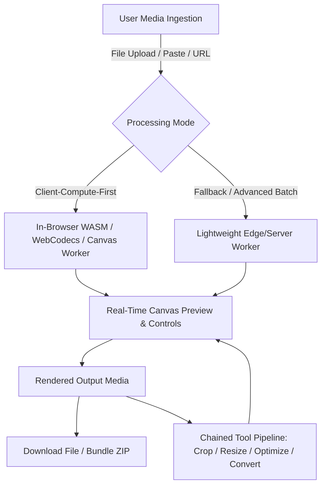
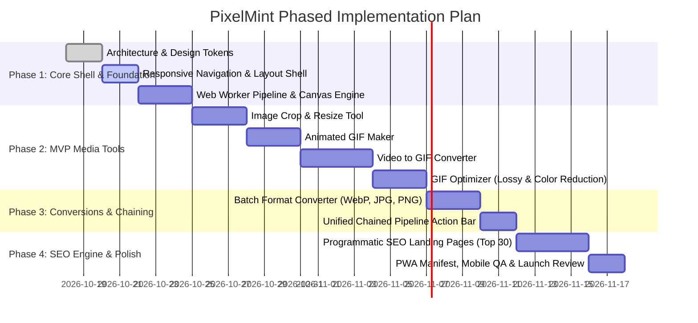

# Product Research & Reverse-Engineering Report: PixelMint
**Project**: Modern, Privacy-First, SEO-Optimized Image & GIF Media Toolkit  
**Benchmark Reference**: [ezgif.com](https://ezgif.com/)  
**Role**: Senior Web Product Researcher & Reverse-Engineering Engineer  
**Date**: October 2026  
**Status**: Research Phase Completed & Verified &mdash; Awaiting Implementation Review  

---

## 1. Executive Summary & Product Vision

### 1.1 Overview
The objective of this initiative is to design and build **PixelMint**, an original, high-performance, responsive, and SEO-dominant web suite for image and animated media manipulation. PixelMint is inspired by the battle-tested functional workflows and programmatic SEO engine of [ezgif.com](https://ezgif.com/), but addresses its major modern shortcomings: legacy 2010s-era visual design, cluttered ad networks causing severe layout shifts, desktop-centric responsive flaws, and reliance on expensive server-side media processing queues.

### 1.2 Benchmark Strengths vs. Modern Opportunity
| Dimension | ezgif.com (Observed Benchmark) | PixelMint (Target Architecture) |
| :--- | :--- | :--- |
| **User Friction** | Zero-friction: No account, no credit card, immediate tool access. | Identical zero-friction philosophy: No signup required, instant drag-and-drop. |
| **Pipeline Workflow** | Chained tool menu allowing users to pass an output directly into Resize, Crop, or Optimize. | **Unified Workspace & Pipeline**: Non-destructive chaining with live preview and history undo/redo. |
| **Processing Architecture** | Historically server-side (uploading files to server; 1-hour deletion policy); recently adding hybrid client-side WASM (2026). | **Client-Compute-First (Zero-Server-Cost Architecture)**: WebAssembly (WASM), Web Workers, and WebCodecs process 90%+ media directly on-device. |
| **User Privacy** | Files uploaded to third-party server temporarily (privacy risk for corporate/sensitive files). | **100% Client-Side Privacy by Default**: "Your media never leaves your browser." |
| **Hosting & Operating Cost** | High CPU, bandwidth, and storage maintenance for server-side transcoding clusters. | **Near $0.00/month initial hosting**: Static hosting via Vercel/Cloudflare CDN; zero server transcoding overhead. |
| **UI/UX & Mobile Usability** | Dense utilitarian layout; 13+ horizontal tabs wrapping into 4-5 cramped rows on mobile; ad-heavy. | Premium aesthetic (sleek dark mode, glassmorphism, responsive bottom-sheet/drawer mobile nav, 60fps UI). |
| **SEO Architecture** | Industry gold standard: Hundreds of programmatic long-tail format conversion and utility landing pages with rich schema. | Replicate and modernize programmatic SEO: Pre-rendered static pages with JSON-LD `WebApplication` and `HowTo` schemas. |

---

## 2. In-Depth Reverse-Engineering of Key Tool Categories

All findings in this section have been verified through direct DOM and page analysis of the live `ezgif.com` service.



---

### 2.1 GIF Maker (`/maker`)
* **Verified Live URL**: `https://ezgif.com/maker`
* **Visible Workflow**:
  1. *Ingestion*: Multi-file picker ("Choose, paste, or drag and drop files here") or remote URL input. Optional toggle between alphabetical auto-sort and manual ordered upload. Checkbox for "Local processing".
  2. *Staging / Frame Assembly*: Generates an interactive thumbnail reel of all uploaded frames.
  3. *Frame Manipulation*: Drag-and-drop reordering (verified using `Sortable.min.js`); individual frame delay input; duplicate/remove frame actions; frame range toggling ("Toggle range from X to Y", "Skip range", "Enable range"); cadence filtering ("Skip every Nth frame").
  4. *Global Configuration*:
     - **Delay Time**: Measured in $1/100$th of a second with dynamic FPS calculator ($FPS = 100 / \text{delay}$).
     - **Gravity Alignment**: Dropdown (`Center`, `Top Left`, `Top Right`, `Bottom Left`, `Bottom Right`) to handle mixed-dimension input images.
     - **Loop Count**: Numeric input ($0$ or blank = loop indefinitely).
     - **Dithering Methods**: Floyd-Steinberg (recommended/best quality), Bayer (ordered), None.
     - **Frame Disposal**: "Don't stack frames" (disposal method 2: restore to background, essential for transparency).
     - **Transitions**: Optional "Crossfade frames" with customizable frame count and fader delay.
  5. *Output Generation*: Renders preview GIF, displays file size, width, height, and frame count.
  6. *Chaining Action Bar*: A unified action bar table offering immediate next-step processing: `Resize`, `Crop`, `Rotate`, `Reverse`, `Speed`, `Cut`, `Optimize`, `Split`, `Frames`, `to MP4`, `Save`.
* **Input Formats**: GIF, JPG, PNG, APNG, HEIC, HEIF, MNG, JP2, AVIF, JXL, BMP, PDF, ANIM, CDXL, FLI, FLC, BPG, WebP, Aseprite, and multi-file ZIP archives.
* **Output Format**: Animated GIF (`.gif`).
* **Documented Limitations & Constraints**:
  - Maximum total upload size: 200MB.
  - Maximum image resolution: $1920 \times 1920$ px (larger images are automatically downsampled).
  - Maximum single frame file size: 50MB.
  - Frame delay minimum: Browser engines enforce a lower clamp (delays $< 2$ [$1/50$ s] are throttled by standard browsers to 10 FPS).

---

### 2.2 Video to GIF Converter (`/video-to-gif`)
* **Verified Live URL**: `https://ezgif.com/video-to-gif`
* **Visible Workflow**:
  1. *Upload / Stream*: Accepts direct video file upload or remote video URL.
  2. *Interactive Video Inspector*: Embedded HTML5 `<video>` player displaying metadata: exact file size, width, height, length in seconds, and container format.
  3. *Trimming Controls*: Precise Start Time and End Time fields in seconds, supplemented with "Use current position" buttons that sample the player's active timestamp.
  4. *Dimension Presets*:
     - `Original (up to 800px)` (Default)
     - `Original (up to 1920px)`
     - Aspect width presets: `600xAUTO`, `540xAUTO` (Tumblr optimized), `500xAUTO`, `480xAUTO`, `400xAUTO`, `320xAUTO`
     - Resolution standards: `AUTOx720` (720p), `AUTOx480` (480p), `AUTOx360` (360p), `AUTOx320` (320p)
     - Banner formats: `up to 1200x300` (wide banner), `up to 300x1200` (skyscraper)
  5. *Framerate & Duration Logic*: Slider + numeric input from 1 to 50 FPS. Dynamic inverse clamp: Higher FPS limits maximum conversion duration (e.g., 5 FPS allows 60s; 10 FPS allows 30s; 25+ FPS allows $<10$s) to prevent out-of-memory errors during quantization.
  6. *Quantization / Color Reduction Engine*:
     - `ezgif (Wu Quantizer + Floyd-Steinberg)`: High visual fidelity, optimal color clusters.
     - `ezgif (Bayer dithering)`: Ordered pattern dithering, faster execution.
     - `ezgif (No dithering)`: Fastest, prone to color banding.
     - `Sequence`: Extracts individual still GIF frames rather than an animation.
  7. *Output & Optimization Advisory*: Rendered GIF accompanied by a notice: *"We advise you to optimize the GIF to reduce file size!"* with a direct 1-click handover to `/optimize`.
* **Input Formats**: MP4, WebM, AVI, MPEG, MKV, FLV, OGG, MOV, M4V, WMV, ASF, 3GP, SWF. Supports video with transparent alpha channels (e.g. VP9/ProRes with alpha).
* **Output Format**: Animated GIF (`.gif`) or sequence archive.
* **Documented Limitations & Constraints**:
  - Maximum upload size: 200MB.
  - Duration limits enforced strictly based on selected framerate to control memory allocation.

---

### 2.3 Image Resizer (`/resize`)
* **Verified Live URL**: `https://ezgif.com/resize`
* **Visible Workflow**:
  1. *Ingestion*: Single file upload or URL, supporting both still and multi-frame animations.
  2. *Current Geometry Display*: Shows original width, height, and file byte size.
  3. *Dimension Controls*:
     - Target Width in px (optional, leave blank for proportional auto-scaling).
     - Target Height in px (optional, leave blank for proportional auto-scaling).
     - Percentage scaling input (e.g., 25%, 50%, 200%).
  4. *Aspect Ratio Conflict Resolution*:
     - `Center and crop to fit`
     - `Stretch to fit`
     - `Force original aspect ratio` (adds transparent padding/letterboxing)
  5. *Canvas Expansion Mode*: Option to expand bounding canvas without resampling pixel data, filling background with user-selected hex color or transparency.
  6. *Coalesce Handling*: Option to coalesce / unoptimize frames before resizing to prevent ghosting or frame corruption on differential-encoded GIFs.
* **Input Formats**: GIF, WebP, APNG, AVIF, JPG, PNG, BMP, HEIC, HEIF, MNG, JXL, ANI, ICO.
* **Output Format**: Preserves input media type while updating dimensions.
* **Documented Limitations & Constraints**:
  - Maximum dimensions: 7680px (8K) for still images; 1920px (Full HD) for animated images.
  - Upscaling animated GIFs causes pixelation or blurring; integer multipliers ($2\times$, $3\times$, $4\times$) produce superior interpolation compared to arbitrary fractions.

---

### 2.4 Image Cropper (`/crop`)
* **Verified Live URL**: `https://ezgif.com/crop`
* **Visible Workflow**:
  1. *Image Ingestion & Preview*: Visual container loading image with interactive rectangular bounding box.
  2. *Interactive Selection*: Handles drag-to-resize and marquee repositioning across desktop mouse and touch viewports.
  3. *Bi-Directional Coordinate Binding*: Real-time inputs for Left (`x1`), Top (`y1`), Width (`w`), and Height (`h`). Editing inputs updates the marquee; moving the marquee updates the numerical fields.
  4. *Aspect Ratio Locking*:
     - Presets: `Original`, `1:1 (Square)`, `4:3`, `16:9`, `3:2`, `2:1`, `1:2`, `2:3`, `3:4`, `4:5`, `5:4`, `9:16`.
     - Specialized: `1.618:1 (Golden Ratio horizontal)`, `1:1.618 (Golden Ratio vertical)`.
  5. *Specialized SVG Crop Handling*: For SVG files, ezgif modifies the SVG `viewBox` attribute directly, producing a cropped vector graphic without rasterizing pixels.
  6. *Auto-Crop Transparency*: One-click trim feature that scans edges to eliminate unused transparent borders.
* **Input Formats**: GIF, WebP, APNG, AVIF, SVG, PNG, JPG, BMP, HEIC, JXL.
* **Output Format**: Cropped file in source container format.
* **Documented Limitations & Constraints**:
  - Cropping animated GIFs where frames have different delta bounding boxes can cause flickering frames unless coalesced.

---

### 2.5 Animated GIF Optimizer & Compressor (`/optimize`)
* **Verified Live URL**: `https://ezgif.com/optimize`
* **Visible Workflow**:
  1. *Image Inspection*: Displays current frame count, file size, and preview.
  2. *Optimization Mode Selection*:
     - **Lossy GIF Compression (Gifsicle LZW Lossy)**: Slider setting compression factor from 5 to 100 (default 30). Injects intentional minor noise to merge LZW compression dictionaries, yielding 30%&ndash;50% file size reduction.
     - **Color Reduction**: Downsamples color palettes from 256 colors down to 128, 64, 32, 16, or custom number.
     - **Drop Every N-th Frame**: Removes every 2nd, 3rd, or 4th frame while doubling the delay of remaining frames to maintain overall animation speed.
     - **Remove Duplicate Frames**: Algorithmic comparison of consecutive frames, removing identical frames and adding their duration to the predecessor.
     - **Optimize Transparency**: Compares frame $N$ with frame $N-1$; replaces unchanged pixels with transparency, keeping only the delta bounding box. Features a "fuzz factor" slider to treat nearly identical colors as identical.
     - **Coalesce (Unoptimize)**: Reverses frame delta optimization into full raw frames for editing compatibility.
  3. *Result Metrics*: Calculates and displays exact savings (e.g. *"-44.2% reduction (1.82MB &rarr; 1.01MB)"*).
* **Input Formats**: GIF (with dedicated sibling tools for WebP, AVIF, and PNG).
* **Output Format**: Optimized GIF.
* **Documented Limitations & Constraints**:
  - High lossy compression values ($>80$) cause noticeable dithering artifacts and visual noise.
  - Transparency optimization is ineffective on converted video (continuous noise across all pixels), but exceptionally effective on screencasts and 2D animations.

---

### 2.6 Effects & Adjustments (`/effects`)
* **Verified Live URL**: `https://ezgif.com/effects`
* **Visible Workflow**:
  1. *Ingestion*: Uploads static or animated media.
  2. *Adjustment Options*:
     - **Color Transforms**: Grayscale, Sepia, Monochrome, Invert / Negative.
     - **Color Balance**: Hue slider ($-180^\circ$ to $+180^\circ$), Saturation slider, Lightness slider, Brightness, Contrast.
     - **Color Tinting**: Hex color input + opacity.
     - **Orientation**: Rotate by $90^\circ$, $180^\circ$, $270^\circ$, or arbitrary angle; Horizontal Flip; Vertical Flip.
     - **Playback Controls**: Reverse animation order; Loop count override; Animation speed multiplier ($0.5\times$, $2\times$, etc.).
     - **Preset Filters**: Instagram-style look-up table (LUT) filters: Gotham, Lomo, Toaster, Vignette, Polaroid, Nashville.
     - **Artistic Convolutions**: Oil paint, Emboss, Posterize, Solarize, Blur, Sharpen, Rounded corners with background fill.
* **Input Formats**: GIF, WebP, APNG, AVIF, MNG, JXL, JPG, PNG, BMP, HEIC/HEIF.
* **Output Format**: Source format with transformations applied across every individual frame.
* **Documented Limitations & Constraints**:
  - Processing filters on high frame-count GIFs ($>150$ frames) can be compute-intensive and cause slow response times on server-side rendering queues.

---

### 2.7 Image Format Conversion Suite (`/converters` & `/webp-to-jpg`)
* **Verified Live URLs**: `https://ezgif.com/converters`, `https://ezgif.com/webp-to-jpg`
* **Visible Workflow**:
  1. *Dual Engine Paradigm*: User toggle switch between **"Server-side mode"** and **"Batch processing in browser"** (client-side).
  2. *Batch Dropzone*: Drag-and-drop zone accepting dozens of files simultaneously.
  3. *Conversion Controls*:
     - Target Quality Factor slider ($1$ to $100$, default $90$).
     - Background Color Picker (default `#ffffff`): Essential when converting transparent PNG/WebP into JPEG, which does not support an alpha channel.
  4. *Multi-Output Pipeline*: Displays each converted image card with individual download buttons, combined with a prominent "Download all as ZIP" button powered by client-side JSZip.
* **Supported Matrix**: Over 80 format combinations:
  - Modern web formats: WebP, AVIF, JPEG XL (JXL), SVG.
  - Standard raster: JPG/JPEG, PNG, BMP, TIFF, ICO.
  - Animated: GIF, APNG, animated WebP, animated AVIF, MNG.
  - Video & Vector: MP4, WebM, MOV, MKV, Lottie JSON, Telegram TGS, SVG.
  - Mobile & Camera: HEIC, HEIF, Apple Live Photo, MVIMG, Camera RAW (CR2, CR3, NEF, ARW, DNG, RAF, ORF, RW2).
* **Documented Limitations & Constraints**:
  - Animated formats converted to static formats (e.g. animated WebP to JPG) unpack into frame sequences rather than a single static file; ezgif packages these into a ZIP file.

---

## 3. SEO Structure, Architecture & Keyword Capture Analysis

### 3.1 Taxonomy & URL Structure
ezgif.com commands millions of monthly search visits primarily through an exhaustive programmatic SEO strategy.
1. **Core Feature Hubs**: Direct short URLs representing primary capabilities:
   - `/maker`, `/video-to-gif`, `/resize`, `/crop`, `/optimize`, `/effects`, `/split`, `/add-text`
2. **Exhaustive Programmatic Converter Pairs**:
   - `/{source}-to-{target}` pattern: `/webp-to-jpg`, `/png-to-jpg`, `/gif-to-mp4`, `/avif-to-png`, `/video-to-gif`, etc.
   - Captures high-intent search queries where users search for an exact conversion need ("convert webp to jpg online free").
3. **Intent-Specific Niche Landing Pages**:
   - `/resize-to-kb` (target file size for visa/passport applications), `/target-size-compressor` (Discord 8MB/Nitro 50MB, Slack 10MB limits), `/doorbell-gif`, `/gif-to-whatsapp-sticker`.

### 3.2 On-Page SEO Blueprint
Every single tool page on ezgif follows an identical, search-engine-optimized content structure:
* **Title Tag Formula**: `[Tool Name] - [Benefit / Free / No Watermark] | [Brand]`  
  *Example*: `Animated GIF Maker - Free Online GIF Editor | ezgif`
* **Meta Descriptions**: Explicitly highlights core value propositions: *"Free online tool. No watermark, no signup, no file limits. Fast and privacy-friendly."*
* **JSON-LD Schema Markup**:
  ```json
  {
    "@context": "https://schema.org",
    "@type": "WebApplication",
    "name": "Animated GIF Maker",
    "url": "https://ezgif.com/maker",
    "applicationCategory": "UtilitiesApplication",
    "operatingSystem": "All",
    "description": "Free online GIF maker...",
    "offers": {
      "@type": "Offer",
      "price": "0",
      "priceCurrency": "USD"
    }
  }
  ```
* **Rich Editorial Content Below Tool**:
  - `<h2>` Editorial overview explaining the mechanics of the format/action.
  - `<ol>` Step-by-step numbered "How-To" guide (targets Google's rich snippet How-To cards).
  - `<h3>` Pro Tips & Best Practices (e.g., explaining why delay $< 2$ flickers, or when to use Wu vs Bayer dithering).
  - `<h4>` Structured FAQ Section (targets Google People Also Ask / PAA boxes).
  - **Internal Semantic Linking Matrix**: Interlinks every related converter in body copy (e.g. on `/webp-to-jpg`, links to `/webp-to-png`, `/jpg-to-webp`, and `/optiwebp`).

---

## 4. Layout, Navigation, and Mobile Usability Assessment

### 4.1 Desktop Layout
* **Header & Logo**: Clean, recognizable brand identity with clear primary category navigation.
* **Double-Tier Navigation**:
  - Tier 1 (`#menu`): Primary format/tool categories (`GIF maker`, `Video tools`, `Transform`, `Optimize`, `Effects`, `WebP`, `AVIF`, etc.).
  - Tier 2 (`#submenu`): Context-sensitive submenu displaying sub-tools matching the active tier 1 selection.
* **Layout Grid**: Two-column layout (~1200px max container). Main stage is ~800px; right sidebar (~300px) is reserved for display ads (300x600 skyscraper) and donation links ("Buy Me a Coffee").

### 4.2 Mobile Responsiveness & Usability Flaws (Key Opportunities for PixelMint)
Through mobile viewport testing (375px & 400px widths), several severe UX shortcomings were identified:
1. **Menu Clutter & Screen Real Estate Hijacking**:
   - ezgif does not use a collapsible hamburger menu or mobile drawer. Instead, its 13 navigation tabs simply wrap into 4-5 stacked rows. On mobile, this eats up 250px-350px of vertical screen space before the user even sees the tool title!
2. **Aggressive Ad Infiltration & Layout Shift (CLS)**:
   - Mobile banner ads (`336x320` and `300x250`) appear directly above the upload field. As ads load asynchronously, they cause jarring layout shifts and push the functional upload button below the fold.
3. **Small Touch Targets**:
   - Coordinate inputs and frame range buttons are styled with standard desktop browser controls, making them difficult to tap accurately on touch screens.
4. **PixelMint's Superior Approach**:
   - Modern mobile bottom navigation bar for primary tools + sleek off-canvas drawer.
   - Clean, zero-layout-shift UI (no intrusive banners pushing controls off-screen).
   - Generous touch targets ($\ge 44 \times 44$ px) with native numeric keyboards and slider scrubbers.

---

## 5. Clean-Room Implementation & Technical Recommendations

### 5.1 Legal & Intellectual Property Boundary
* **Strict Principle**: Zero copying of proprietary source code, CSS, server scripts, logos, or copy.
* **Clean-Room Implementation**: We leverage standard public algorithms (Wu quantization, Floyd-Steinberg dithering, LZW compression, Lanczos resampling) and standard open-source libraries under permissive licenses (MIT, Apache 2.0, BSD).

### 5.2 Recommended Technical Architecture: "Client-Compute-First"

```mermaid
graph LR
    subgraph ClientBrowser [User Browser (100% Client-Side Processing)]
        UI[Next.js Modern Responsive UI]
        WW[Dedicated Web Worker Pool]
        Canvas[OffscreenCanvas 2D API]
        WASM_GIF[gifenc / gifsicle WASM]
        WASM_CODEC[@jsquash WebP / AVIF / JPEG]
        WCodecs[Native WebCodecs API]
        
        UI --> WW
        WW --> Canvas
        WW --> WASM_GIF
        WW --> WASM_CODEC
        WW --> WCodecs
    end

    subgraph CDN [Static Edge Hosting ($0 Cost)]
        Vercel[Vercel / Cloudflare Pages CDN]
        SSG[Pre-rendered Static SEO Pages]
        Vercel --> SSG
    end

    SSG -.->|Loads App Shell| ClientBrowser
```

#### Why Client-Compute-First?
1. **$0 Hosting Bill**: Image processing is computationally intensive. By offloading 90%+ of resizing, cropping, GIF creation, video decoding, and palette quantization to the user's browser, server compute and bandwidth costs drop to near-zero.
2. **Instant Privacy**: Images and personal videos never leave the client's device. No GDPR/CCPA storage liabilities, no upload wait times, and no temporary file deletion pipelines required.
3. **Blazing Speed**: Instant processing with zero network latency on file upload and download.

### 5.3 Library & Technology Selection

| Category | Recommended Technology / Library | License | Justification |
| :--- | :--- | :--- | :--- |
| **Framework** | **Next.js (App Router, Static Export / SSG)** | MIT | Allows static generation of 200+ programmatic SEO landing pages (`/{from}-to-{to}`) deployed directly to global CDN. Fast page loads, automatic metadata, zero server runtime needed. |
| **Styling & Design** | **Vanilla CSS with Design Tokens (CSS Variables)** | Clean-room | Full control, ultra-lightweight ($<25\text{ KB}$ total CSS), sleek dark/light theme, modern glassmorphism, responsive grid without heavy runtime overhead. |
| **GIF Encoding & Quantization** | **`gifenc`** (by Matt DesLauriers) + **`gifsicle-wasm-browser`** | MIT | `gifenc` is a modern, ultra-fast, memory-efficient GIF encoder written in JS/ESM with custom Floyd-Steinberg dithering and NeuQuant color quantization. `gifsicle-wasm` provides lossy LZW compression identical to ezgif. |
| **Video Decoding & Frame Capture** | **WebCodecs API** + fallback **`@ffmpeg/ffmpeg` (WASM)** | Native / MIT | WebCodecs decodes MP4/WebM/H.264/VP9/AV1 frames using native hardware acceleration in modern browsers with 0KB library overhead. WASM FFmpeg provides fallback for legacy containers (AVI, MKV, FLV). |
| **Modern Image Codecs** | **`@jsquash/webp`**, **`@jsquash/avif`**, **`@jsquash/resize`**, **`@jsquash/png`** | Apache 2.0 | High-performance WebAssembly builds created by the Google Chrome team for browser-based modern image processing. |
| **Canvas Manipulation & Filters** | **Native `OffscreenCanvas` in Web Workers** | Native | Runs all cropping, resizing, rotations, color adjustments, and convolution matrix filters off the main UI thread to maintain fluid 60fps responsiveness. |
| **Cropping UI** | **`Cropper.js v2`** (or custom lightweight Pointer-Event Canvas overlay) | MIT | Touch-friendly, high-performance canvas crop box with aspect ratio locking. |
| **Batch Archiving** | **`client-zip`** or **`jszip`** | MIT | `client-zip` is 30x faster and uses streaming memory to create ZIP files on-the-fly for batch conversion downloads. |
| **Hosting Infrastructure** | **Cloudflare Pages** or **Vercel Hobby Tier** | Free Tier | Unlimited static asset requests, global edge CDN, automatic HTTPS, continuous deployment. Total recurring hosting cost: **$0.00/month**. |

---

## 6. Risk Assessment & Mitigation Matrix

| Risk Identified | Impact | Probability | Mitigation Strategy |
| :--- | :---: | :---: | :--- |
| **Browser Memory Exhaustion** on long 4K videos or 300+ frame GIFs | High | Medium | Implement strict progressive chunking: process and encode frames in a streaming pipeline rather than holding all raw uncompressed RGBA pixel buffers in memory. Cap preview canvas resolution. |
| **Older Browser Compatibility** (lack of WebCodecs or Web Workers support) | Medium | Low | Feature-detect WebCodecs. Fall back to HTML5 `<video>` seek-and-draw canvas capture. Detect WebAssembly; alert user if browser lacks modern WASM capabilities. |
| **SEO Cannibalization / Thin Content Penalties** across programmatic pages | High | Medium | Do not publish pure empty template clones. Ensure every programmatic format page (`/webp-to-jpg`, `/png-to-jpg`) contains customized, technically accurate format guides, unique FAQs, and distinct step-by-step instructions. |
| **High Processing Times on Mobile Devices** | Medium | Medium | Default to conservative presets on mobile (e.g., default 10 FPS instead of 25 FPS for Video-to-GIF, max 600px width on phones). Provide a visual progress indicator with cancellation capability. |

---

## 7. Phased Implementation Roadmap



### Phase 1: Foundation & Responsive Application Shell (Days 1&ndash;7)
* Establish project workspace, semantic HTML structure, and Vanilla CSS design token system (`index.css`) supporting Dark/Light modes.
* Build responsive layout with clean desktop header and mobile drawer/bottom navigation.
* Implement background Web Worker messaging pipeline and `OffscreenCanvas` processing harness.

### Phase 2: MVP Core Tools (Days 8&ndash;20)
* **Image Crop & Resize**: Interactive marquee selection, aspect ratio locking, pixel and percentage resizing.
* **Animated GIF Maker**: Drag-and-drop frame reel, frame reordering, individual and global delay calculation, NeuQuant/Wu quantization.
* **Video to GIF**: HTML5 video timeline preview, timestamp start/end markers, resolution/FPS presets, hardware-accelerated WebCodecs frame extraction.
* **GIF Optimizer**: Gifsicle WASM lossy LZW compression slider, color depth reduction, frame dropping.

### Phase 3: Conversions & Tool Chaining (Days 21&ndash;28)
* Multi-format batch converter (`WebP`, `JPG`, `PNG`, `AVIF`, `GIF`) with background color picker for transparency flattening.
* Fast in-browser ZIP packaging via `client-zip`.
* Inter-tool chaining menu: seamlessly pass output of one tool into another with zero re-upload.

### Phase 4: Programmatic SEO Engine & Launch (Days 29&ndash;35)
* Implement static site generation (SSG) for top 30 search intent pairs (`/webp-to-jpg`, `/video-to-gif`, `/resize-gif`, `/crop-gif`, `/gif-optimizer`, etc.).
* Embed rich structured data (`WebApplication`, `HowTo`, `FAQPage` JSON-LD schema).
* Comprehensive cross-browser and mobile device verification.

---

## 8. Verification & Review Sign-Off

* **Source Inspection Status**:
  - Homepage (`https://ezgif.com/`): Verified via direct DOM inspection and Browser Subagent screenshots.
  - GIF Maker (`https://ezgif.com/maker`): Verified via direct DOM inspection.
  - Video to GIF (`https://ezgif.com/video-to-gif`): Verified via direct DOM inspection.
  - Resize (`https://ezgif.com/resize`): Verified via direct DOM inspection.
  - Crop (`https://ezgif.com/crop`): Verified via direct DOM inspection.
  - Optimize (`https://ezgif.com/optimize`): Verified via direct DOM inspection.
  - Effects (`https://ezgif.com/effects`): Verified via direct DOM inspection.
  - Converters (`https://ezgif.com/converters` & `/webp-to-jpg`): Verified via direct DOM inspection.
* **Implementation Gate**:
  - In strict compliance with instructions, **no project code, framework scaffolding, or package dependencies have been installed or modified**.
  - This report is now submitted for product stakeholder review before commencing Phase 1.
